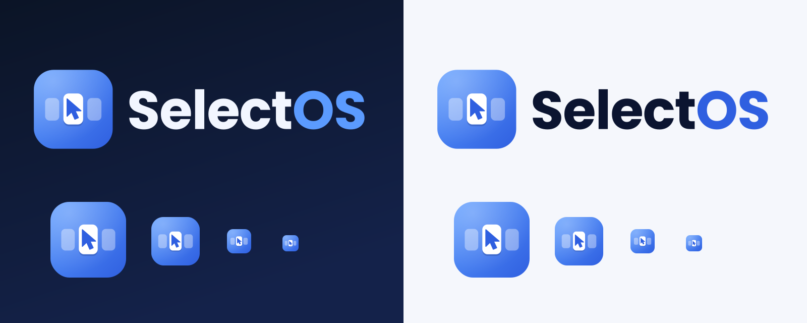

# SelectOS branding



The mark is three OS cards with the middle one selected by a pointer: *choose your OS*.

## Files (`assets/branding/`)

| File | Use |
| ---- | --- |
| `svg/selectos-logo-dark-bg.svg` / `-light-bg.svg` | Full logo (mark + name). Dark-bg has white text, light-bg has navy text. Text is converted to outlines, no font needed. |
| `svg/selectos-mark.svg` | Mark only (square). App icon, avatar, favicon source. |
| `png/selectos-mark-{1024,512,256,128,64,32}.png` | Mark, transparent corners. |
| `png/selectos-logo-{dark,light}-bg.png` | Full logo, transparent background. |
| `png/social-preview.png` | 1280x640 repository social card. |
| `make_logo.py` | Regenerates everything (`pip install cairosvg fonttools`, then `python3 make_logo.py`; add `--alt` for the check-mark variant). |

## Colours and type

| Token | Value |
| ----- | ----- |
| Blue (light) | `#5b9bff` |
| Blue (dark) | `#2f5fe0` |
| Navy text / dark UI | `#0b1430` / `#080c1a` |
| Wordmark | Poppins Bold, "Select" in text colour, "OS" in blue |

Minimum size: mark 32 px, full logo 120 px wide. Keep clear space of at least a quarter of the mark's height around it. Do not stretch, recolour the cards, or add effects.

## In the boot selector

`config/select.json` supports a logo shown top-left on every screen:

```json
"brand": { "name": "SelectOS", "subtitle": "Multi-boot Selector", "logo": "icons/selectos.png" }
```

`logo` is a PNG path on the boot partition (the image builder copies `icons/`). If the file is missing or unreadable, the selector falls back to a plain blue ring. Older runtimes ignore the field.

## GitHub social preview

Repository **Settings → General → Social preview → Upload an image**, then choose `assets/branding/png/social-preview.png`. (This cannot be set from a commit.)
